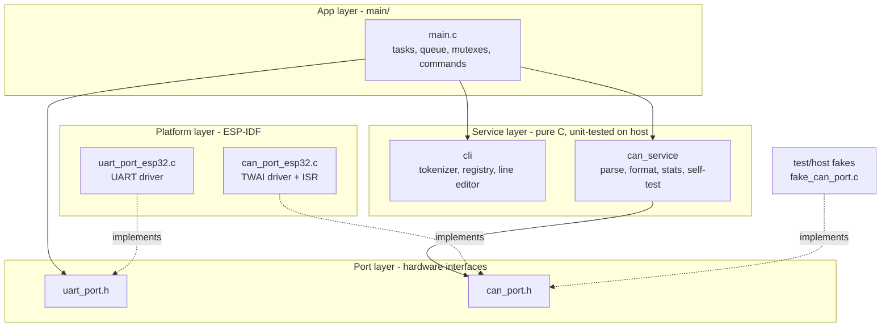
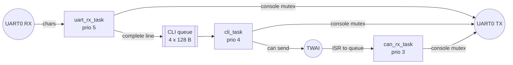
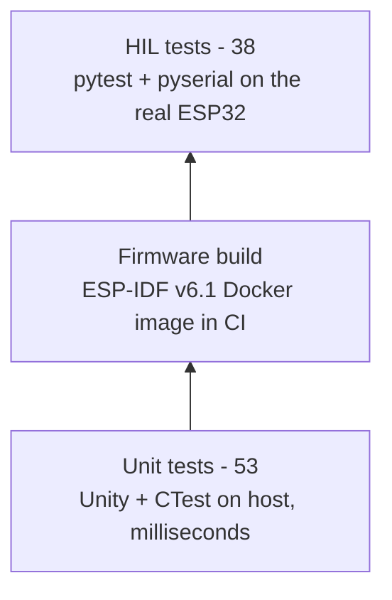

# ESP32 CAN/UART Command Interface

[](https://github.com/benjamin-thomas-02/esp32-can-uart-cli/actions/workflows/ci.yml)


FreeRTOS firmware for the ESP32 that provides a **UART command-line interface** to a
**CAN (TWAI) controller**: send frames, monitor traffic, read statistics and run a
built-in loopback self-test.

The focus of this project is **professional embedded workflow**: a layered,
hardware-independent architecture, **host-based unit tests** (Unity), a **CI pipeline**
(GitHub Actions + ESP-IDF Docker) and an automated **hardware-in-the-loop (HIL)** test
suite (pytest + pyserial).

---

## Features

- **UART CLI** with line editing (backspace), command registry and argument parsing
- **CAN (TWAI)**: send standard/extended frames, live monitor, TX/RX statistics
- **CAN self-test** in loopback mode – runs on a single board, no transceiver needed
- **System diagnostics**: heap usage and per-task stack high-water marks
- **3 FreeRTOS tasks** with queue-based message passing and mutex-protected shared resources
- **91 automated tests**: 53 host unit tests + 38 HIL tests on real hardware
- **CI on every push**: unit tests + reproducible firmware build, firmware binaries as artifacts

## Example session

```
> help
  help       List all commands
  version    Show firmware version
  uptime     Time since boot in ms
  echo       Print the arguments back
  sys        Heap and task stack usage
  can        CAN: send | stats | monitor | selftest
> can monitor on
CAN monitor on
> can send 123 11 22
[CAN RX] ID=0x123 DLC=2 11 22
TX ID=0x123 DLC=2 11 22
> can send 0x1ABCDE AA
[CAN RX] ID=0x001ABCDE EXT DLC=1 AA
TX ID=0x001ABCDE EXT DLC=1 AA
> can stats
tx_ok=2 tx_err=0 rx=2
> can selftest 50
CAN self-test PASS: sent=50 ok=50 mismatch=0 timeout=0 tx_err=0
> can send 123 1FF
data byte must be hex 00-FF
usage: can send <id> [b0 .. b7]  (hex)
ERR: invalid argument
```

---

## Architecture

The firmware is split into four layers. Only the **platform layer** depends on ESP-IDF;
the **service layer** is plain C and is unit-tested on a PC with fake hardware ports.



| Layer | Component | Depends on |
|---|---|---|
| App | `main/` | everything below, FreeRTOS |
| Service | `components/cli`, `components/can_service` | standard C, `ports` only |
| Port | `components/ports` (headers only) | nothing |
| Platform | `components/platform_esp32` | ESP-IDF UART + TWAI drivers (private) |

ESP-IDF drivers are **private** dependencies of the platform component, so the build
system itself prevents upper layers from calling hardware APIs directly.

### Runtime design (FreeRTOS)



| Task | Priority | Responsibility |
|---|---|---|
| `uart_rx_task` | 5 | Read characters, line editing, echo; never blocked by slow commands |
| `cli_task` | 4 | Parse and execute commands received through the queue |
| `can_rx_task` | 3 | Receive CAN frames, update statistics, print monitor output |

- **Queue** decouples input handling from command execution.
- **Console mutex** keeps output lines from three tasks intact.
- **CAN RX ownership lock** lets the self-test take exclusive use of the receiver.
- **ISR → queue → task**: the TWAI receive callback only copies the frame into a
  FreeRTOS queue (`xQueueSendFromISR`); all processing happens in task context.

---

## Testing



| Level | Tool | What it checks | Where it runs |
|---|---|---|---|
| **Unit** | Unity, CMake/CTest | Tokenizer, line editor, command registry, CAN frame parser/formatter, statistics, self-test logic | PC and CI, no hardware |
| **Build** | ESP-IDF Docker image | Firmware compiles reproducibly with the pinned ESP-IDF version | CI (GitHub Actions) |
| **HIL** | pytest, pyserial | Real device behaviour: CLI, CAN send/monitor/stats/self-test, error handling, stack health | PC with board connected |

Highlights:
- **Fake hardware ports** (link-time substitution) allow fault injection – dropped,
  corrupted and failed CAN frames – that is hard to reproduce on real hardware.
- **Boundary tests** for every limit (max arguments, max line length, max DLC, 11/29-bit IDs).
- HIL suite **resets the board** via RTS/EN before each session and checks that every task
  keeps a safe stack margin.

---

## Getting started

### Requirements
- ESP32 dev board (tested on ESP32-D0WD-V3)
- [ESP-IDF v6.1](https://docs.espressif.com/projects/esp-idf/en/stable/esp32/get-started/index.html)
- For unit tests: `gcc`, `cmake` ≥ 3.20
- For HIL tests: Python 3.10+

### Hardware
No wiring needed: the CAN self-test uses **GPIO 21 for both TWAI TX and RX**, so the
controller reads its own signal back through the GPIO matrix (loopback + self-test mode).

For a **real CAN bus**, add a transceiver (e.g. SN65HVD230), set `CAN_RX_GPIO` to a
separate pin in `components/platform_esp32/can_port_esp32.c` and use
`CAN_PORT_MODE_NORMAL`.

### Build and flash
```bash
idf.py set-target esp32
idf.py build
idf.py -p /dev/ttyUSB0 flash monitor
```

### Run unit tests (no hardware)
```bash
cmake -S test/host -B build-host
cmake --build build-host
ctest --test-dir build-host --output-on-failure
```

### Run HIL tests (board connected, serial monitor closed)
```bash
python3 -m venv .venv
source .venv/bin/activate
pip install -r hil/requirements.txt
pytest hil --port /dev/ttyUSB0
```

---

## CLI reference

| Command | Description |
|---|---|
| `help` | List all commands |
| `version` | Firmware version |
| `uptime` | Milliseconds since boot |
| `echo <words>` | Print arguments back |
| `sys` | Free heap, minimum heap, stack high-water mark per task |
| `can send <id> [b0 .. b7]` | Send a frame (hex). IDs above `0x7FF` are sent as 29-bit extended IDs |
| `can stats [reset]` | Show or reset TX/RX counters (self-test traffic excluded) |
| `can monitor [on\|off]` | Print every received frame |
| `can selftest [1-100]` | Loopback self-test with a unique pattern per frame |

---

## Project structure

```
components/
  cli/              CLI tokenizer, command registry, line editor (pure C)
  can_service/      CAN parser, formatter, statistics, self-test (pure C)
  ports/            Hardware interfaces: uart_port.h, can_port.h
  platform_esp32/   ESP-IDF implementations (UART driver, TWAI driver + ISR)
main/               App: FreeRTOS tasks, queue, mutexes, command handlers
test/host/          Unity unit tests + fakes (built with host gcc)
hil/                pytest + pyserial hardware-in-the-loop tests
.github/workflows/  CI: unit tests + ESP-IDF firmware build
```

---

## Design decisions

- **Ports and adapters**: hardware access only through small C interfaces, so logic is
  testable on a PC and portable to other MCUs.
- **Dependency injection**: the CLI receives its output function at init, so tests can
  capture output without hardware.
- **No dynamic allocation** in application code: fixed-size buffers, predictable memory.
- **Short ISRs**: interrupt callbacks only copy data into a queue.
- **Locking rules**: never hold two locks at once (no deadlock), short critical sections,
  mutexes with priority inheritance.
- **Single writer per shared counter**: lock-free statistics without lost updates.
- **Strict input validation** with specific error messages for every invalid input.

---

## Roadmap

- [ ] Two-node CAN bus with SN65HVD230 transceivers (`CAN_PORT_MODE_NORMAL`)
- [ ] Self-hosted GitHub Actions runner to run the HIL suite in CI
- [ ] Static analysis (cppcheck) in the CI pipeline
- [ ] CAN acceptance filters and bus error/state reporting

---

## Author

**Benjamin Thomas** – Embedded firmware engineer, M.Sc. Applied Computer Science student
GitHub: [@benjamin-thomas-02](https://github.com/benjamin-thomas-02)
